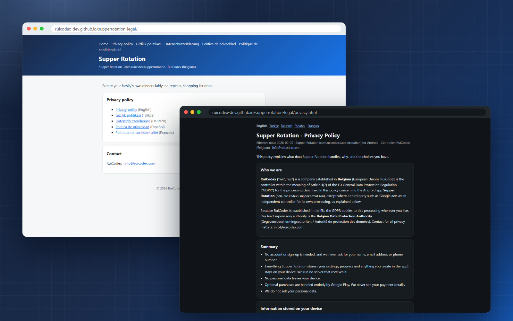
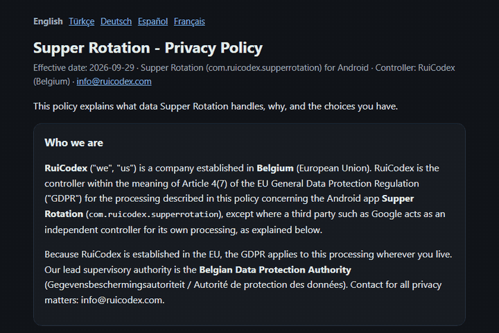
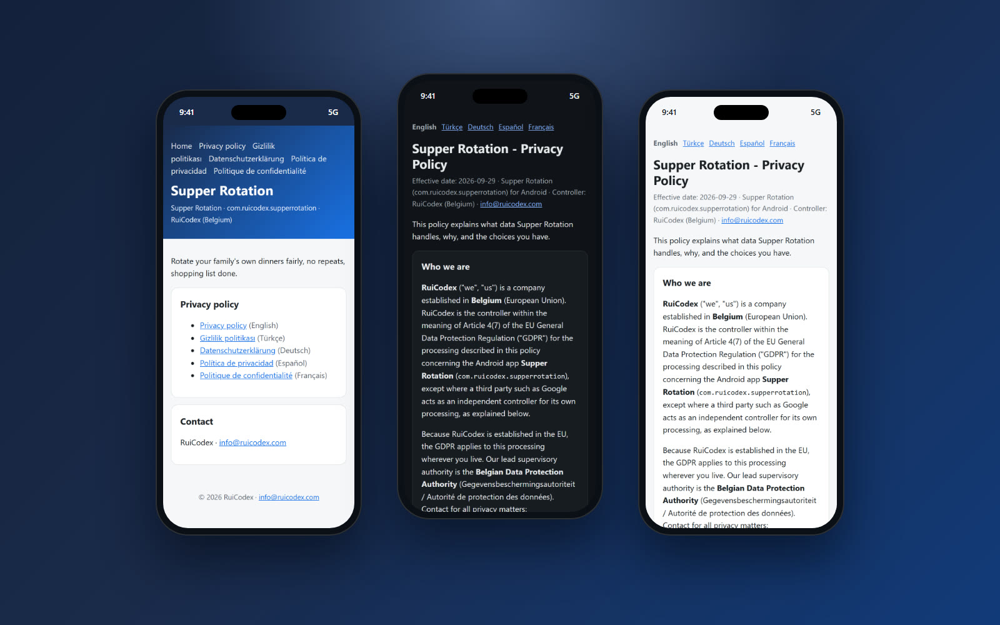
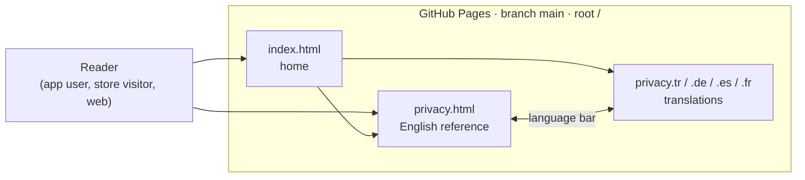
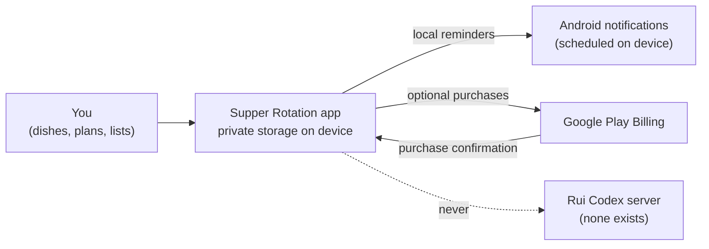

<div align="center">

<picture>
  
</picture>

**The public privacy policy for Supper Rotation, the Android app that rotates your family's own dinners fairly, with no repeats and the shopping list done.**


[**Live site**](https://ruicodex-dev.github.io/supperrotation-legal/) &nbsp;·&nbsp;
[**Privacy policy**](https://ruicodex-dev.github.io/supperrotation-legal/privacy.html) &nbsp;·&nbsp;
[**Pages and languages**](#pages-and-languages) &nbsp;·&nbsp;
[**Edit a policy**](#getting-started) &nbsp;·&nbsp;
[**Rui Codex**](https://ruicodex.com)

</div>

<br>

<p align="center">
  
</p>

## What this is

This repository is the source of the **Supper Rotation legal site**, served by GitHub Pages straight from the `main` branch.
It holds the privacy policy for the Supper Rotation Android app (`com.ruicodex.supperrotation`), which takes the dinners your
family already cooks and rotates them fairly, without repeats, and builds the shopping list for you. The policy is written once
in English and published in four more languages. There is no build step, no script and no tracking: six hand-written HTML files
with inline CSS that follow the reader's light or dark system theme.

<table>
<tr>
<td width="33%" valign="top">

**🔒 Nothing leaves the device**<br>
Your dishes, plans and settings stay in the app's private storage. No account, and no Rui Codex server receives anything.

</td>
<td width="33%" valign="top">

**🙅 No account, no analytics**<br>
The app never asks for a name, email or phone number, and uses no analytics or crash-reporting service.

</td>
<td width="33%" valign="top">

**🛒 Purchases via Google Play**<br>
Optional purchases run through Google Play Billing. Rui Codex never sees card or payment details.

</td>
</tr>
<tr>
<td valign="top">

**🌍 Five languages**<br>
English, Türkçe, Deutsch, Español and Français, each with a language bar so readers can switch in one tap.

</td>
<td valign="top">

**⚖️ Written for the GDPR**<br>
Controller in Belgium, legal bases by article, the Belgian Data Protection Authority, KVKK notes for Türkiye.

</td>
<td valign="top">

**🪶 Zero dependencies**<br>
No JavaScript, no external fonts, no cookies, no analytics. `.nojekyll` makes Pages serve the files exactly as written.

</td>
</tr>
</table>

## What the policy says

A short, faithful digest of the English policy (effective **2026-09-29**, 16 sections). The policy itself is the reference;
read it in full on the [live site](https://ruicodex-dev.github.io/supperrotation-legal/privacy.html).

| Topic | In short |
| --- | --- |
| Account | None. The app never asks for a name, email address or phone number. |
| Your data | Settings, history and everything you create stay in the app's private storage on your device. No server receives them. |
| Purchases | Handled by Google Play Billing, with Google as an independent controller. Only the product id and the purchase confirmation are kept on the device, so a purchase can be unlocked and restored. |
| Notifications | Reminders are scheduled locally by the app; nothing is sent from a server. They can be switched off in the app or in Android Settings. |
| Analytics | None. No analytics or crash-reporting service is used in this app. |
| Who receives data | Google (Play billing), the email provider when you write to Rui Codex, and authorities only where the law requires it. No sale of data, no data brokers. |
| Retention | App data stays until you delete it; Rui Codex holds no copy. Support emails are kept only as long as needed, at most three years. |
| Children | Intended for users aged 13 and over; younger users need a parent's or guardian's consent where the law requires it. |
| Deletion | Reset in the app (where available), clear storage in Android Settings, or uninstall. |
| Your rights | GDPR rights (access, erasure, portability, objection and more), KVKK for Türkiye, UK GDPR and Swiss law, and US state rights. Requests are answered within one month, free of charge. |

## Pages and languages

<p align="center">
  
</p>

| Page | File | Live |
| --- | --- | --- |
| Home (links to every language) | [`index.html`](index.html) | [open](https://ruicodex-dev.github.io/supperrotation-legal/) |
| Privacy Policy (English, reference text) | [`privacy.html`](privacy.html) | [open](https://ruicodex-dev.github.io/supperrotation-legal/privacy.html) |
| Gizlilik Politikası (Türkçe) | [`privacy.tr.html`](privacy.tr.html) | [open](https://ruicodex-dev.github.io/supperrotation-legal/privacy.tr.html) |
| Datenschutzerklärung (Deutsch) | [`privacy.de.html`](privacy.de.html) | [open](https://ruicodex-dev.github.io/supperrotation-legal/privacy.de.html) |
| Política de privacidad (Español) | [`privacy.es.html`](privacy.es.html) | [open](https://ruicodex-dev.github.io/supperrotation-legal/privacy.es.html) |
| Politique de confidentialité (Français) | [`privacy.fr.html`](privacy.fr.html) | [open](https://ruicodex-dev.github.io/supperrotation-legal/privacy.fr.html) |

Each translation carries a note that it is provided for convenience and that the English version prevails where the texts
differ, unless mandatory law says otherwise.

<p align="center">
  
</p>

## How it works

The site itself is a handful of linked static pages:



And this is the data flow the policy describes for the app:



A push to `main` is all it takes to update the site: Pages publishes the repository root as is (`.nojekyll` turns off Jekyll processing).

## Tech stack

| Layer | Choice |
| --- | --- |
| Pages | Hand-written HTML5, one file per page and language |
| Styling | Inline CSS with custom properties, `prefers-color-scheme` dark palette, system font stack |
| Hosting | GitHub Pages from `main`, root folder |
| Tooling | None needed. Any editor and any static file server |

## Getting started

**Preview locally** (any static server works):

```bash
git clone https://github.com/RuiCodex-dev/supperrotation-legal.git
cd supperrotation-legal
python -m http.server 8000
# open http://localhost:8000/
```

**Change the policy**

1. Edit the English reference, `privacy.html`, and update the effective date in its `.meta` line.
2. Carry the same change into `privacy.tr.html`, `privacy.de.html`, `privacy.es.html` and `privacy.fr.html`, so all five stay in step.
3. Check every page in light and dark mode and at phone width, then commit to `main`. Pages redeploys on its own.

<details>
<summary><b>Adding a language</b></summary>

<br>

1. Copy `privacy.html` to `privacy.<code>.html` (for example `privacy.nl.html`), set `<html lang="<code>">` and translate.
2. Add the translation note (the English version prevails) under the introduction, like the other translations.
3. Add the new language to the language bar (`<nav class="langs">`) in **every** privacy page.
4. Add it to the header links and the list in `index.html`, with a matching `hreflang`.

</details>

## Project structure

```text
supperrotation-legal/
├── index.html          # home: app tagline, links to every language, contact
├── privacy.html        # Privacy Policy (English, reference text)
├── privacy.tr.html     # Gizlilik Politikası
├── privacy.de.html     # Datenschutzerklärung
├── privacy.es.html     # Política de privacidad
├── privacy.fr.html     # Politique de confidentialité
├── .nojekyll           # serve files as is on GitHub Pages
└── docs/media/         # README banner, badges and captures
```

## FAQ

<details>
<summary><b>Which language version is binding?</b></summary>

<br>

The English text. Every translation states that it is provided for convenience and that the English version prevails where they differ, unless mandatory law requires otherwise.

</details>

<details>
<summary><b>Does Supper Rotation send my meal plans or shopping lists anywhere?</b></summary>

<br>

No. According to the policy, everything you create in the app stays on your device, and no personal data leaves it. The only outside party involved is Google Play, and only when you make an optional purchase.

</details>

<details>
<summary><b>Does this site track visitors?</b></summary>

<br>

The pages contain no scripts, cookies, external fonts or analytics. Hosting is GitHub Pages; GitHub's own server logging is covered by GitHub's terms.

</details>

<details>
<summary><b>Who do I contact about privacy?</b></summary>

<br>

Rui Codex, Belgium: info@ruicodex.com, with "Privacy – Supper Rotation" in the subject line. You can also complain to the Belgian Data Protection Authority or the authority where you live, as the policy explains.

</details>

---

<div align="center">

**All rights reserved, © 2026 Rui Codex.** The policy texts may not be reused for other products without permission.

Built by **[Rui Codex](https://ruicodex.com)** · Contact: info@ruicodex.com

<sub>Media credits: all screenshots and the language GIF are real captures of the live site; the banner (an illustration of a dinner rotation, not app UI) and badges are hand-built SVG. No generated imagery, narration or music is used in this README.</sub>

</div>
